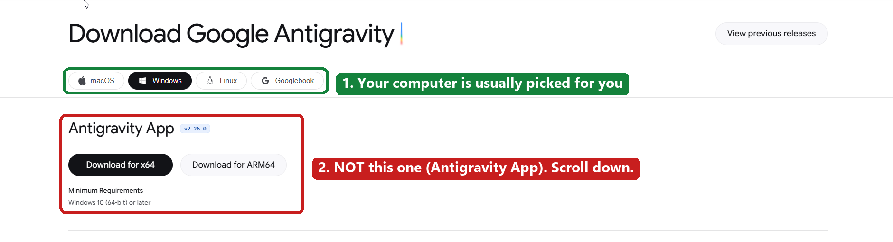
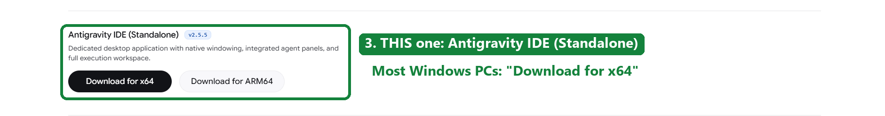

# Setup: Getting Ready (about 15 minutes)

You'll install a free app called **Antigravity IDE** (what's an IDE? see below), sign in with a Google account, and open the course in it. After that, the course teaches itself: an AI tutor inside the app takes over.

> **You don't need any technical experience.** If something here doesn't match your screen, that's normal (apps update often). Take your best guess, and once the tutor is running, tell it what happened.

<!-- Authors: steps marked ⚠️ weren't captured in testing yet. Verify them on the next fresh install (QA pass 2). -->

## First: what's an "IDE"?

**IDE** stands for **integrated development environment**. That's a technical name for a simple idea: **one app that keeps everything for a project in one window.** You get a list of your files, a place to read and edit them, and (in newer IDEs) an **AI assistant that can work on those files with you**.

Programmers use IDEs to write software, but you don't need to be a programmer to use one. Picture a word processor and a filing cabinet in the same window, with a capable assistant beside you who can read your documents and make changes you approve.

**Why use an IDE for this course, instead of a chat website like Gemini or ChatGPT?**

- A chat website only sees what you paste into it. In an IDE, the AI can **open your files, create new ones, and edit them**, with you reviewing each change.
- It can **remember things by writing them down** in files, so your work doesn't vanish when the chat ends.
- That's the difference between a chatbot that *talks* and an **agent** that *does work*. Learning to direct and check an agent is what this course is about.
- It's also how the course teaches itself. The tutor is an AI agent that reads the lesson files and saves your progress.

**Antigravity IDE** is Google's free IDE with a built-in AI agent. Google makes several products called "Antigravity," which is why step 1 is careful about which one to download.

*(Curious for more? Wikipedia has a short overview: [Integrated development environment](https://en.wikipedia.org/wiki/Integrated_development_environment). You don't need it for the course.)*

## 1. Download the right app

1. Go to **https://antigravity.google/download**.
2. Near the top, make sure your kind of computer is selected (**macOS**, **Windows**, …). It's usually picked for you.
3. ⚠️ **The first download on the page is the wrong one.** It's called **Antigravity App**, and it's a different product. **Don't click its buttons. Scroll down.**

   

4. Keep scrolling past **Antigravity CLI** (commands in boxes) and **Antigravity for IDEs** (Visual Studio Code, JetBrains, Zed, Xcode, each with a **View Docs** button). You don't need any of these.
5. Near the bottom, find **Antigravity IDE (Standalone)**. Its heading is smaller than the others, so it's easy to miss. **This is the one you want.**

   

6. Click the button for your computer:
   - **Windows:** **Download for x64** works for almost all Windows PCs. Choose **ARM64** only if your laptop has a Snapdragon / ARM chip. To check, go to **Settings → System → About → System type**.
   - **Mac:** **Download for Apple Silicon** if your Mac has an M1, M2, M3 or newer chip. Choose **Download for Intel** for older Macs. To check, open **Apple menu → About This Mac → Chip / Processor**.

## 2. Install it

Open the file you downloaded (usually in your **Downloads** folder) and follow the installer. On a Mac, drag Antigravity into **Applications**.

## 3. Sign in with Google ⚠️

1. Open **Antigravity IDE**. It will ask you to sign in with Google, usually by opening your web browser.
2. Choose a Google account and approve the sign-in. **A personal Google account is simplest.** University Google accounts sometimes block new apps. (The course never uses real patient or research data, so a personal account is fine for it.)
3. Go back to the app. You should see **Welcome to Antigravity IDE** and **Success, Continuing…** Click **Next**.

## 4. The setup screens (7 short steps)

| Screen | What to choose |
|---|---|
| **Welcome to Antigravity IDE** | Click **Next**. |
| **Choose setup flow** | **Start fresh**, then **Next**. (The import options are for people moving from another editor.) |
| **Select Theme** | Any look you like. Dark and light both work. Click **Next**. |
| **How do you want to use the Antigravity IDE Agent?** | **Review-driven development** (marked *Recommended*). The AI checks with you before changing things, and reviewing its work is a big part of this course. |
| **Configure Your Editor** | Leave **Normal** and **Recommended** selected. Click **Next**. |
| **Build with Google** | Leave everything **unchecked**. You won't need these. Click **Next**. |
| **Security Notice & Data Use** | Read it. The first box (letting Google use your interactions to improve the product) **is checked by default, and it's your choice.** Uncheck it if you prefer. The email box is optional. Click **Next**. |

## 5. Get the course

1. On the course's GitHub page, click the green **Code** button, then **Download ZIP**.
2. **Unzip it.**
   - **Windows:** right-click the ZIP and choose **Extract All…** → **Extract**. (Don't just double-click it. Opening files from inside a ZIP doesn't work.)
   - **Mac:** double-click the ZIP. It unzips into a folder.
3. Optionally, move the unzipped folder somewhere easy to find, like **Documents**.

## 6. Open the course in Antigravity

1. In Antigravity: **File → Open Folder…**
2. Choose the unzipped course folder. It's the one that contains `README.md`, `lessons`, and `world`. (If you see just one folder inside another with the same name, go into it.)
3. ⚠️ If asked whether you trust the authors of the files, choose **Yes, I trust the authors**. The course needs this so the tutor can work.
4. You should see the course's folders listed in the **Explorer** panel.

## 7. Start the course

1. Open the **agent panel**: press **Ctrl+L** (Windows) or **Cmd+L** (Mac). Or click **Code with Agent** in the middle of the window.
2. In the message box (it says *"Ask anything, @ to mention, / for actions"*), type:

   ```
   /start-course
   ```

   and press **Enter**.

The tutor takes it from here. Replies can take a few seconds, so be patient. 🎓

## If something goes wrong

- **I downloaded the wrong app** (there's no list of files on one side and no **File → Open Folder** menu): you probably got the **Antigravity App**. Go back to step 1 and get **Antigravity IDE (Standalone)**, near the bottom of the page. You can uninstall the other one.
- **Sign-in fails with a university account:** try a personal Google account.
- **The tutor doesn't seem to know about the course:** make sure you opened the course folder itself (step 6.2), not the ZIP or a folder above it.
